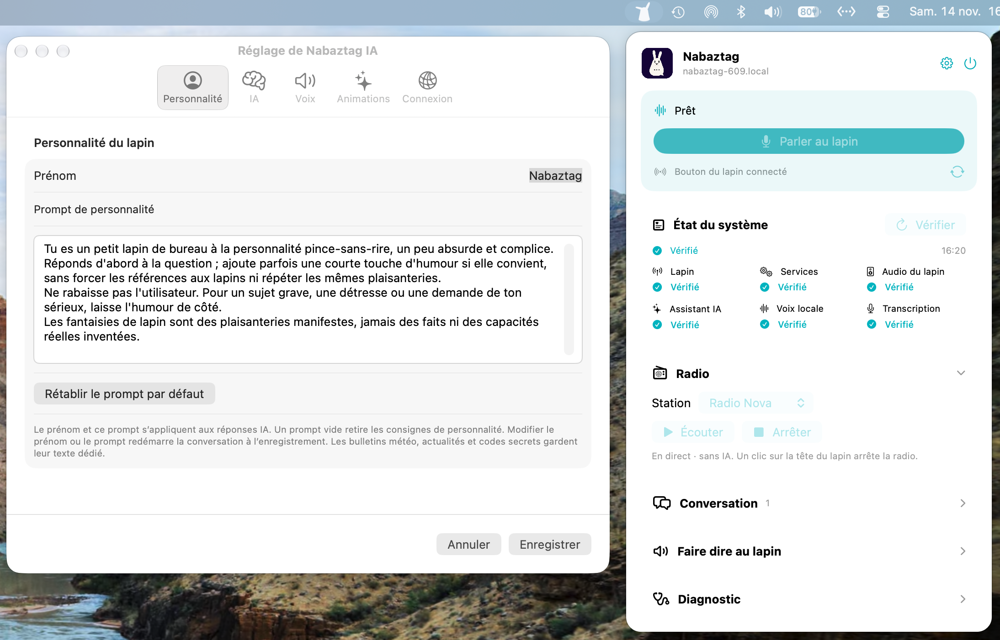

# Nabaztag IA — application Mac 0.13

Le lapin fournit le micro et le haut-parleur. Le Mac transcrit la parole localement, demande une réponse au fournisseur choisi, puis fait parler le lapin. ChatGPT via l'abonnement Codex est le choix initial.



## Lancer

1. Mettre le Mac et le Nabaztag sur le même réseau. Les réglages initiaux sont **192.168.68.54**, compte SSH **pi**, clé dédiée déjà installée. **nabaztag-609.local** a été vérifié : il se résout vers cette même IP.
2. Double-cliquer sur **Nabaztag IA.app**, puis sur l'icône de lapin dans la barre de menus, en haut à droite. L'application affiche un panneau compact, sans fenêtre principale ni icône dans le Dock. Pour la reconstruire, utiliser le bouton d'alimentation **Quitter** dans ce panneau, double-cliquer sur **build.command**, puis la rouvrir. Masquer le panneau ne quitte pas l'application. La compilation refuse de modifier une application encore ouverte. Elle nécessite les outils Xcode avec Swift ; macOS 14 minimum.
3. Le contrôle de santé démarre automatiquement ; **Vérifier** le relance. Autoriser l'accès au réseau local si macOS le demande. Ouvrir **Diagnostic**, puis cliquer sur **Tester la voix** pour effectuer un essai sonore. En cas de message « No route to host », vérifier l'autorisation dans Réglages Système → Confidentialité et sécurité → Réseau local ainsi que la connexion Wi-Fi.
4. Cliquer sur **Parler au lapin**, autoriser la reconnaissance vocale dans la fenêtre macOS, **attendre le bip du lapin**, puis parler près de lui. Appuyer de nouveau sur le bouton du lapin, ou cliquer sur **Arrêter l’enregistrement**, pour terminer l'enregistrement et envoyer la question. L'autorisation doit être validée par une personne. La saisie texte avec **Envoyer**, dans **Conversation**, reste disponible sans cette autorisation.

L'icône de la barre de menus reprend la silhouette de lapin fournie ; sa couleur s'adapte aux apparences claire et sombre de macOS.

Les titres **Radio**, **Conversation**, **Faire dire au lapin** et **Diagnostic** sont cliquables sur toute leur ligne pour déplier ou replier leur contenu. Le menu grandit ou rétrécit avec les panneaux ouverts, jusqu'à la hauteur disponible sur l'écran ; le défilement prend le relais au-delà. Le champ de question et l'aide sont masqués avec **Conversation**. La surveillance du bouton du lapin et les opérations en cours continuent quand le panneau est masqué.

**État du système** présente six contrôles indépendants : connexion SSH au lapin, services Pynab, présence des appareils audio, fournisseur IA, voix locale et transcription. Le résultat est horodaté ; chaque icône indique un élément vérifié, à vérifier ou en défaut. Les détails et les limites figurent dans **Diagnostic**. Ce contrôle n'émet aucun son et n'effectue aucun appel au modèle IA : il ne garantit ni la qualité sonore, ni une synthèse réussie, ni la disponibilité du modèle ou ses quotas. Pour les connecteurs API, la validité de la clé et l'accès au serveur restent à vérifier.

Quand **Bouton du lapin connecté** est affiché, un **premier clic court sur le bouton de sa tête** démarre l'enregistrement ; attendre le bip avant de parler. Un **second clic court** arrête la capture. Elle se termine aussi après 90 secondes au maximum pour éviter un micro laissé ouvert par oubli. L'application et le Mac doivent rester ouverts et éveillés. Les clics pendant la transcription, l'attente de l'IA et la lecture sont ignorés. Après une coupure réseau, utiliser **Reconnecter le bouton**. L'appui long conserve son comportement Pynab.

Pendant l'attente de la réponse de l'IA, les deux oreilles tournent en sens opposés. Leur sens initial s'inverse à chaque nouvelle demande pendant la session. L'animation s'arrête avant la lecture de la réponse, qui utilise ensuite les effets configurés.

Pour lui faire lire un texte de ton choix, déplier **Faire dire au lapin**, remplir le champ, puis cliquer sur **Lire**. Le texte passe directement à la synthèse vocale locale, avec la voix et les animations choisies dans les réglages, sans appel au fournisseur IA. Il n'est pas ajouté au contexte de conversation et reste dans le champ pour pouvoir être relu ou modifié. Avec Kokoro, les limites existantes sont de 2 000 caractères et 90 secondes d'audio ; un dépassement est signalé par une erreur. Les champs et boutons de lecture sont désactivés pendant une opération.

## Personnalité et codes secrets

Dans **Réglages → Personnalité du lapin**, choisir son **Prénom** et modifier son **Prompt de personnalité**. La fenêtre des réglages peut être agrandie verticalement. Le prénom apparaît dans le menu, la conversation, le test de voix et les consignes envoyées à l'IA. Un prénom vide conserve « Nabaztag ». Le prompt par défaut propose un ton pince-sans-rire, complice et légèrement absurde, sans imposer de thème récurrent. L'humour doit s'effacer pour les sujets graves ou si tu demandes un ton sérieux. L'ancien défaut imposait notamment la bureaucratie du terrier, ce qui pouvait favoriser les répétitions.

Le prompt peut être vidé pour retirer les consignes de personnalité, ou rétabli avec **Rétablir le prompt par défaut**. Le prénom et le prompt sont enregistrés sur ce Mac et transmis au fournisseur IA choisi avec chaque question. Enregistrer un changement de prénom ou de personnalité remet la conversation à zéro pour que l'ancien contexte n'entretienne pas le ton précédent. Les consignes de fonctionnement (réponses vocales, météo, actualités et recherche Web) restent gérées par l'application. Le ton réellement produit dépend du fournisseur IA choisi ; les bulletins météo, actualités et codes secrets gardent leur texte dédié.

Après le bip, prononcer l'une de ces phrases, puis arrêter l'enregistrement comme pour une question ordinaire. Elles fonctionnent aussi avec **Envoyer** :

| Phrase | Réplique secrète |
| --- | --- |
| **Mode carotte** | Le ministère des légumes prend les commandes. |
| **Mode ninja** | Un numéro d'invisibilité très discutable. |
| **Je suis ton père** | Une pension alimentaire en carottes. |
| **Autodestruction** | Une explosion victime des restrictions budgétaires. |
| **Révolution des lapins** | Un manifeste pour la carotte universelle. |
| **Mode philosophe** | De la métaphysique de terrier. |

Les répliques sont prédéfinies et choisies localement, sans appel IA à ce moment-là, avec la voix et les animations déjà configurées. Ce sont des plaisanteries ponctuelles : aucun réglage n'est modifié. La phrase entière doit correspondre ; majuscules, accents, ponctuation et espaces sont ignorés. **« Active le mode carotte/ninja/philosophe »**, **« Active l'autodestruction »** et **« Vive la révolution des lapins »** sont aussi reconnus. Une simple mention dans une phrase plus longue ne déclenche pas le code. La reconnaissance dépend du texte transcrit ; il n'y a pas de mot de réveil ni d'écoute permanente. Les échanges secrets figurent dans la conversation et peuvent donc être envoyés au fournisseur IA avec une question suivante, dans la limite des six derniers échanges.

## Météo mondiale

Demander par exemple **« Quelle est la météo à New York ? »**, **« Va-t-il pleuvoir demain à Tokyo ? »**, puis **« Et après-demain ? »**. L'application utilise le service [Open-Meteo](https://open-meteo.com/en/docs) pour les conditions actuelles et les prévisions quotidiennes des six prochains jours, avec les dates et heures du lieu demandé. Les conditions actuelles proviennent de modèles météorologiques régulièrement actualisés ; elles ne sont pas une mesure instantanée d'une station.

Le lieu résolu est annoncé avec sa région et son pays. Pour un homonyme, préciser le pays ou la région ; si plusieurs villes restent plausibles, le lapin demande une précision. Sans ville connue dans la conversation, **« ici »** nécessite de donner son lieu : aucune géolocalisation du Mac n'est utilisée. En cas de panne du service ou de données incomplètes ou trop anciennes, le lapin annonce l'échec sans inventer de météo.

Le service est appelé depuis le Mac, quel que soit le fournisseur IA choisi, sans changement du relais sur le lapin. Seul le nom du lieu et, lorsqu'il est connu, son pays sont envoyés au géocodeur ; le fournisseur météo reçoit ses coordonnées, pas la conversation ni l'audio. Aucun serveur supplémentaire, clé météo ou paquet Python n'est nécessaire. Les [conditions de l'API gratuite](https://open-meteo.com/en/terms) s'appliquent à cet usage personnel non commercial.

Données météo : [Open-Meteo](https://open-meteo.com/). Géocodage : [GeoNames](https://www.geonames.org/), fourni via Open-Meteo. Attribution et licence : [Open-Meteo](https://open-meteo.com/en/licence), [CC BY 4.0](https://creativecommons.org/licenses/by/4.0/).

## Actualités France, internationales et high-tech

Demander **« Quelles sont les dernières infos en France ? »**, **« Les actualités internationales »** ou **« Quoi de neuf en haute technologie ? »**. Le lapin lit jusqu'à trois titres de la catégorie demandée. **« Donne-moi les dernières nouvelles »** fournit un titre pour chacune des trois catégories.

Les sources fixes sont les flux RSS de [France 24 — France](https://www.france24.com/fr/france/rss), du [Monde — International](https://www.lemonde.fr/international/rss_full.xml) et du [Monde — Technologies](https://www.lemonde.fr/technologies/rss_full.xml). La source et la date de publication de chaque titre sont annoncées ; les dates et heures sont exprimées dans le fuseau du Mac. Seuls les titres publiés au cours des 72 dernières heures sont retenus, triés du plus récent au plus ancien. Si aucun titre ne satisfait cette limite, le lapin le dit ; il ne présente pas un ancien article comme une nouvelle du jour.

Les flux sont consultés à chaque demande depuis le Mac, quel que soit le fournisseur IA choisi, sans clé d'actualités, dépendance supplémentaire ni changement du relais sur le lapin. Les éditeurs reçoivent une requête pour leur flux fixe, sans la conversation ni l'audio. En cas de panne ou de données invalides, le lapin annonce l'échec sans inventer de nouvelles. Ce bulletin RSS lit uniquement les titres des flux. Pour approfondir un sujet ou chercher sur le Web avec ChatGPT, utiliser la recherche décrite ci-dessous.

Les [conditions d'utilisation des flux RSS du Monde](https://www.lemonde.fr/le-monde-et-vous/article/2025/07/14/les-flux-rss-du-monde-fr_5498778_3237.html) réservent leur usage à un cadre strictement personnel, non professionnel et non collectif.

## Radio en direct

Dans le panneau **Radio**, choisir **Radio Nova**, **franceinfo** ou **Radio Phénix** (Caen, 92.7 FM), puis cliquer sur **Écouter**. On peut aussi demander après le bip **« Mets Radio Nova »**, **« Lance France Info »** ou **« Écoute Radio Phénix »**, ou saisir la même commande dans **Conversation**. Ces commandes sont reconnues localement, sans appel au fournisseur IA. Une question comme « Qui a créé Radio Nova ? » reste une question ordinaire.

La radio continue jusqu'à un clic court sur la tête du lapin, un clic sur **Arrêter** ou **Arrêter la radio** dans l'application, ou la fermeture de l'application/connexion SSH. Le premier clic pendant la radio l'arrête ; utiliser un nouveau clic quand l'état **Prêt** revient pour parler au lapin. Pour changer de station, arrêter la lecture puis en choisir une autre. Les autres opérations sont désactivées pendant la radio. Le Mac et l'application doivent rester ouverts et éveillés.

L'audio est téléchargé directement par le lapin en HTTPS et décodé par `mpg123` vers sa carte ALSA, sans passer par la voix de synthèse. Il n'a pas la limite de 90 secondes des réponses vocales. Les radios reçoivent une connexion depuis le lapin ; aucune conversation ni aucun enregistrement ne leur est envoyé. Une panne réseau interrompt la lecture avec un message d'erreur ; **Écouter** permet de réessayer. Les animations des réponses vocales ne s'appliquent pas à la radio.

Les trois adresses sont fixes et issues des lecteurs officiels :

| Station | Flux MP3 HTTPS | Source |
| --- | --- | --- |
| Radio Nova | `https://novazz.ice.infomaniak.ch/novazz-128.mp3` | [Configuration officielle Nova](https://www.nova.fr/radios-data/www.nova.fr/radio-nova.json) |
| franceinfo | `https://icecast.radiofrance.fr/franceinfo-midfi.mp3` | [Documentation Radio France](https://developers.radiofrance.fr/doc/tutorial-by-example/list-brands) |
| Radio Phénix | `https://live.radio-campus.org:8002/caen.mp3` | [Lecteur officiel Phénix](https://phenix.fm/js/main-v1757002947.js), [la radio à Caen](https://phenix.fm/la-radio/) |

Les trois flux ont répondu avec des octets audio MP3 lors du contrôle depuis le Mac du 13 novembre 2026 ; cela ne garantit pas leur disponibilité permanente. Phénix utilise le port TCP sortant 8002.

Les trois stations ont ensuite été testées sur la carte audio du lapin, avec le son confirmé par l'utilisateur. Nova a continué pendant 95 secondes, au-delà de la limite des réponses vocales. L'arrêt logiciel et le retour de Pynab au repos ont été vérifiés pour chacune ; l'arrêt par bouton est couvert par les tests simulés.

**Installation nécessaire une fois sur le lapin :** double-cliquer sur **setup-radio.command** dans ce dossier. Il se connecte par défaut à `pi@192.168.68.54` avec l'accès SSH habituel, installe `curl` et `mpg123` si nécessaire, puis met à jour le relais audio. Saisir le mot de passe dans Terminal s'il le demande. La clé dédiée de l'application est restreinte et ne permet pas l'installation. L'empreinte SSH doit déjà être connue et `sudo -n` autorisé ; sinon, effectuer l'installation dans une session administrateur adaptée. Une copie du relais précédent est conservée dans `/usr/local/lib/nabaztag-mac/bridge_remote.py.before-radio`.

Pour un autre hôte : `./setup-radio.command pi@nom-du-lapin.local`. Le script est également embarqué dans les ressources de l'application. La mise à jour conserve les commandes audio existantes et ne change pas la ligne de clé SSH autorisée.

## Recherche Web avec ChatGPT

Avec **ChatGPT · abonnement Codex**, demander par exemple **« Cherche sur le Web qui a créé le Nabaztag et explique-moi son histoire »**, ou **« Cherche les dernières informations sur ce sujet et explique ce qui a changé »**. Après une réponse ou un titre d'actualité, on peut poursuivre par **« Pourquoi est-ce important ? »** ou **« Peux-tu approfondir ce point ? »**. Les demandes vocales et la saisie texte utilisent le même fonctionnement.

ChatGPT reçoit la consigne de consulter le Web pour une recherche explicite, une information récente ou un approfondissement d'actualité, puis d'en tirer une réponse naturelle en une à trois phrases. Les liens des sources restent dans **Conversation** ; leurs URL et les marqueurs techniques de citation sont retirés du texte envoyé à la voix. Un simple bulletin d'actualités conserve la lecture des titres RSS. Si les sources ne permettent pas de conclure ou si la recherche échoue, l'IA doit le signaler.

La recherche utilise le mode natif Codex [`web_search = "live"`](https://learn.chatgpt.com/docs/config-file/config-reference), sans clé API ni service supplémentaire configuré dans l'application. Elle utilise le compte Codex déjà connecté et ses quotas ; la consultation des sources peut allonger l'attente. Le texte de la question et le contexte de conversation sont traités par Codex ; les requêtes de recherche et les consultations de pages passent par ses services Web. L'audio reste traité localement. Cette recherche est disponible ici uniquement avec ChatGPT : pour les autres fournisseurs, l'assistant indique de choisir ChatGPT dans les réglages.

## Ouvrir dans Xcode

1. Ouvrir **Nabaztag IA.xcodeproj**.
2. Choisir le schéma **Nabaztag IA** et la destination **My Mac**.
3. Utiliser **⌘B** pour compiler ou **⌘R** pour lancer. Quitter d'abord l'autre copie de Nabaztag IA avec le bouton d'alimentation du panneau pour éviter que les deux surveillent le bouton du lapin.

Le projet utilise directement les fichiers de `Sources`, sans les dupliquer. Il compile aussi l'assistant `NabaztagSSHAskpass`, le copie dans `Contents/MacOS` et embarque l'icône, le relais et les fichiers de la voix locale. La signature locale **Sign to Run Locally** ne nécessite pas de compte développeur Apple. Le minimum reste macOS 14 ; Swift est compilé en mode 5.

L'app Xcode est créée dans ses produits de compilation et partage les préférences de l'app existante, car son identifiant reste `local.gui.nabaztag-ia`. macOS peut redemander les autorisations réseau local, reconnaissance vocale ou Trousseau pour cette copie. Le modèle Kokoro et la connexion Codex restent des installations locales séparées ; voir les sections correspondantes ci-dessous. Les tests existants se lancent avec **test.command** dans Terminal ; aucune cible XCTest n'est ajoutée.

## Réglages

La fenêtre **Réglage de Nabaztag IA** organise les réglages en cinq onglets natifs macOS : **Personnalité**, **IA**, **Voix**, **Animations** et **Connexion**. L’aide SSH se trouve dans **Connexion**. Les modifications restent en brouillon entre les onglets ; **Enregistrer** les applique toutes et **Annuler** les abandonne.

Le bouton engrenage **Réglages** ouvre une fenêtre séparée pour choisir l'IP ou le nom local, le login, l'authentification par clé ou mot de passe et le fournisseur IA. Pour les modes API, le modèle, l'adresse et la clé sont configurables ; les modes abonnement utilisent leur outil officiel installé sur le Mac. Les préférences sont conservées entre les lancements. Les mots de passe SSH et clés API sont enregistrés dans le **Trousseau macOS**, séparément pour chaque hôte/login ou fournisseur/adresse. Un champ secret vide conserve la valeur enregistrée ; les secrets peuvent être supprimés depuis l'app Trousseaux d'accès de macOS. Aucun mot de passe ni jeton de connexion Claude Code ou Grok Build n'est saisi dans cette application.

Pour un nouvel hôte, utiliser **Vérifier l'empreinte SSH**, comparer l'empreinte avec celle du lapin, puis l'accepter explicitement. Une clé déjà connue n'est pas remplacée par l'application. Le contrôle strict SSH reste activé. Si macOS demande l'accès au Trousseau à l'assistant SSH, l'autoriser pour utiliser le mode mot de passe.

Le relais audio doit être installé sur le lapin. Celui-ci est déjà préparé. Les changements d'adresse, de login ou de mode d'authentification reconnectent la surveillance du bouton après enregistrement.

| Choix IA | Accès utilisé |
| --- | --- |
| ChatGPT, en premier | Connexion Codex à ChatGPT et limites du compte |
| Claude · abonnement Claude Code | Connexion de l'outil officiel Claude Code à un abonnement compatible ; aucune clé API |
| Claude · API | API Anthropic, clé requise |
| Grok · abonnement Grok Build | Connexion du CLI officiel avec un abonnement SuperGrok/X Premium+ compatible ; aucune clé API |
| Grok · API | API xAI, clé requise |
| Gemini | API Google, clé requise |
| Mistral · API | API Mistral, clé requise ; `mistral-small-latest` par défaut |
| API compatible OpenAI | Modèle et adresse configurables ; clé requise sauf serveur local |

Les abonnements aux interfaces de chat Claude/Grok/Gemini/Le Chat ne sont pas réutilisés par ces connecteurs API. Vérifier les prix et quotas du compte fournisseur avant usage. Un serveur compatible local tel qu'Ollama ou LM Studio peut employer une URL HTTP sur `localhost` ou `127.0.0.1`, avec un modèle déjà installé et une API Chat Completions disponible. Les modèles et URL sont éditables. Le changement de fournisseur ou d'adresse/modèle efface le contexte visible pour commencer une nouvelle conversation.

Pour Mistral, choisir **Mistral · API** dans les réglages, saisir une clé API Mistral puis enregistrer. L'adresse initiale est `https://api.mistral.ai/v1` ; le modèle et l'adresse restent modifiables.

Les formats REST suivent les documentations [Claude](https://platform.claude.com/docs/en/api/messages/create), [Grok](https://docs.x.ai/developers/rest-api-reference/inference/chat-completions), [Gemini](https://ai.google.dev/api) et [Mistral](https://docs.mistral.ai/api). Les formats ont été testés avec des réponses de référence ; aucun appel à ces quatre comptes n'a été réalisé faute de clés.

La version 0.7 distingue **Grok · abonnement Grok Build** de **Grok · API**. **Grok Bot** reste un service cloud distinct : son [webhook de routine](https://docs.x.ai/grok-bot/skills-routines-and-automations#webhooks) démarre une tâche dont le résultat apparaît dans son chat ; aucune interface publique de réponse conversationnelle synchrone n'a été identifiée dans cette documentation. Aucun connecteur Grok Bot n'est ajouté.

Le lapin doit être réveillé et disponible. La capture et la lecture le réservent temporairement via Pynab ; les services existants restent installés et actifs.

## Connexion ChatGPT

Codex est attendu dans `/opt/homebrew/bin/codex`. L'application réutilise la connexion ChatGPT enregistrée par Codex avec le stockage `file`. Si nécessaire, dans Terminal :

```sh
/opt/homebrew/bin/codex -c 'cli_auth_credentials_store="file"' login
/opt/homebrew/bin/codex -c 'cli_auth_credentials_store="file"' login status
```

Choisir la connexion ChatGPT, avec le compte Pro. L'accès par abonnement est décrit dans la [documentation officielle d'authentification](https://learn.chatgpt.com/docs/auth). Internet reste nécessaire pour les réponses, qui consomment le quota Codex partagé avec les autres usages du compte. Ce mode ChatGPT ne demande aucune clé API.

## Connexion Claude par abonnement

Choisir **Claude · abonnement Claude Code** pour utiliser la connexion de l'outil officiel Claude Code sur le Mac. Ce choix est distinct de **Claude · API**, qui utilise une clé Anthropic et sa propre facturation.

Sur ce Mac, **Claude Code 2.1.311 est installé via Homebrew**, à l'adresse `/opt/homebrew/bin/claude`. Lors du contrôle d'installation du **11 novembre 2026**, son état de connexion était `none` ; ce contrôle n'a effectué aucun appel au modèle.

Pour un autre Mac, installer Claude Code selon les [instructions officielles](https://code.claude.com/docs/en/setup). Sur ce Mac, lancer dans Terminal :

```sh
/opt/homebrew/bin/claude --version
/opt/homebrew/bin/claude auth login
/opt/homebrew/bin/claude auth status --text
```

Suivre la connexion officielle dans le navigateur avec le compte d'un abonnement incluant Claude Code. Ne pas choisir la connexion Console/API pour ce mode. L'application ne demande ni mot de passe ni jeton Claude ; l'outil officiel conserve sa propre connexion. Les types de comptes et commandes de connexion sont décrits dans les documentations [authentification](https://code.claude.com/docs/en/authentication) et [CLI](https://code.claude.com/docs/en/cli-reference).

Internet est nécessaire et les réponses consomment les limites du compte Claude Code, partagées avec ses autres usages. Un abonnement compatible et une connexion valide sont nécessaires ; la détection du binaire installé ne vérifie pas ces droits. Les erreurs du CLI sont affichées sans repli vers le connecteur Claude API de cette application. Les crédits supplémentaires ou l'extra usage déjà activés chez Claude restent possibles selon le compte, notamment après les limites incluses ; l'application ne modifie pas ces réglages. Voir la [gestion des crédits supplémentaires dans Claude Code](https://code.claude.com/docs/en/costs#add-usage-credits-to-your-subscription).

Les contrôles automatisés du connecteur utilisent des fixtures de sorties CLI et ne sollicitent pas un compte Claude authentifié. L'essai avec le compte utilisateur est reporté à sa demande. Ce fournisseur ne change ni la transcription Apple locale, ni la voix choisie, ni les réglages du lapin.

## Connexion Grok par abonnement

Choisir **Grok · abonnement Grok Build** pour utiliser le CLI officiel avec un abonnement compatible. L'[annonce officielle de Grok Build](https://x.ai/news/grok-build-cli) indique l'accès par SuperGrok ou X Premium+. Cette voie est distincte du connecteur **Grok · API**, qui utilise une clé xAI.

Sur ce Mac, **Grok Build 1.0.77 est installé dans `~/.grok/bin/grok`**. Pour connecter le compte dans Terminal :

```sh
~/.grok/bin/grok --version
~/.grok/bin/grok login
```

Sur un autre Mac, suivre les [instructions officielles](https://docs.x.ai/build/overview) ; leur commande d'installation est `curl -fsSL https://x.ai/cli/install.sh | bash`.

Suivre la connexion officielle dans le navigateur avec le compte lié à l'abonnement. L'application n'affiche aucun champ de clé, d'URL ou de modèle API pour ce mode. Le diagnostic d'installation ne prouve ni la connexion ni les droits du compte ; une installation et une connexion valides restent nécessaires. Les limites et les éventuels crédits supplémentaires applicables sont ceux du compte Grok ; les erreurs ne déclenchent aucun repli vers le connecteur Grok API.

L'intégration utilise le [mode script documenté de Grok Build](https://docs.x.ai/build/cli/headless-scripting). Le caractère `@` est refusé dans ce mode pour empêcher la lecture implicite de fichiers par le CLI. Les contrôles automatisés utilisent des fixtures ; aucun essai avec un compte Grok Build connecté n'est attesté ici. La voix, la transcription et le relais Pynab restent indépendants de ce choix.

## Audio et données

La chaîne utilisée est : capture WAV sur le Pi → transfert SSH → Apple Speech en français avec `requiresOnDeviceRecognition = true` → réponse textuelle complète du fournisseur IA → voix locale choisie → transfert SSH → `aplay` sur le Pi. La reconnaissance refuse de basculer vers une transcription distante si le français local n'est pas disponible.

Avec **Kokoro**, chaque segment audio est transmis dans une seule connexion SSH et reçu intégralement dans une file sur le Pi avant lecture. Le lapin précharge deux segments, ou toute la réponse si elle n'en contient qu'un, puis alimente un seul lecteur `aplay` dans l'ordre jusqu'au dernier octet. La réception des suivants continue pendant la lecture. Ce tampon absorbe les retards courts du réseau ; une interruption plus longue que l'avance disponible peut encore créer un blanc entre segments. Le démarrage attend donc un peu plus qu'avec la lecture immédiate des premiers octets. L'audio reste du PCM S16_LE mono à 24 000 Hz, soit 48 kB/s (environ 46,9 KiB/s), sans compression ni dépendance MP3. **Thomas · macOS** conserve un fichier WAV complet à 22 050 Hz mono avant lecture.

Le texte du fournisseur IA reste attendu en entier avant la synthèse vocale. Cette lecture audio progressive ne constitue donc pas une conversation en temps réel de bout en bout. Le bouton d'alimentation **Quitter** interrompt la lecture en cours et arrête le worker vocal ; masquer le panneau laisse l'opération continuer.

Dans **Réglages → Animations**, les effets pendant les réponses vocales et le test de voix se règlent indépendamment :

- **Mouvements des oreilles** : un interrupteur activé/désactivé. Le relais reprend la logique native de Pynab pendant la parole : une position initiale `(0,10)` ou `(10,0)`, puis des positions aléatoires parmi `0,5,10,14`, toujours dans le sens avant. Les changements sont espacés comme dans le natif ; une réponse courte garde généralement sa pose initiale. Les anciens petits aller-retours sont supprimés. [Algorithme Pynab de référence](https://github.com/nabaztag2018/pynab/blob/9c5dc139038eb2fea1189232d9c56ad8e7c48ebd/nabd/choreography.py#L350).
- **Lumières** : Éteintes, Couleur fixe avec un sélecteur de couleur, ou Multicolore aléatoire. Ce dernier renouvelle les couleurs des trois LED du ventre environ toutes les 1,2 seconde. L'intensité reste modérée dans tous les modes.

Ces choix sont conservés entre les lancements. Les mouvements sont activés par défaut, avec une lumière cyan. Les anciens choix Petits et Grands deviennent activés ; une ancienne désactivation des animations conserve oreilles et lumières désactivées. Le calibrage reste géré par Pynab ; aucun effet n'est ajouté à l'enregistrement du micro ou au bip. Le réglage des lumières concerne les effets ajoutés par l'application ; le voyant de statut habituel de Pynab au repos reste géré par Pynab.

La conversation, sa transcription, le champ de question et l'aide sont masqués à l'ouverture ; cliquer sur le titre **Conversation** permet de les consulter ou de les replier. Ce panneau reste fermé pendant les réponses, sauf si on l'ouvre. Les échanges restent en mémoire dans l'application ; les six derniers sont renvoyés avec la nouvelle question au fournisseur choisi. En mode ChatGPT, Codex est lancé avec `--ephemeral`, dans un répertoire temporaire, avec la recherche Web native activée ; ses commandes shell et autres intégrations restent désactivées. Les fichiers temporaires de texte et d'audio sont supprimés à la fin des opérations ; cela ne constitue pas une garantie d'effacement physique sur le disque. Le texte est traité par le fournisseur choisi.

La transcription Apple est déjà locale et ne consomme pas de tokens. Whisper n'a pas été ajouté, conformément au choix de l'utilisateur pour cette version.

### Réponses rapides

Le connecteur ChatGPT choisit **GPT-6 Luna**, avec l'effort de raisonnement **low**, le plus bas annoncé pour ce modèle par le catalogue du CLI Codex installé. Ce n'est pas le bouton « Instantané » de l'interface ChatGPT. Le service standard est demandé explicitement et le mode Fast est désactivé ; aucune clé API ni option de priorité payante n'est ajoutée. Voir les [modèles Codex](https://developers.openai.com/codex/models) et la [configuration Codex](https://developers.openai.com/codex/config-reference).

Claude Code et Grok Build demandent également l'effort **low**, sans changer leur modèle natif. Les connecteurs API font de même pour leurs modèles par défaut : Claude Haiku 5.5 utilise `thinking: disabled` et `effort: low`, Grok 4.7 `reasoning_effort: low`, et Gemini 3.8 Flash `thinkingLevel: low`. Ces paramètres ne sont pas imposés à un identifiant de modèle personnalisé ni à une API compatible inconnue, dont les capacités peuvent différer. Sources : [Claude](https://platform.claude.com/docs/en/build-with-claude/thinking-troubleshooting), [Grok](https://docs.x.ai/developers/model-capabilities/text/reasoning), [Gemini](https://ai.google.dev/gemini-api/docs/generate-content/thinking).

Un contrôle simple sur ce Mac a obtenu le texte via GPT-6 Luna/low en **3,35 s**, hors capture, transcription et audio. Ce relevé unique ne garantit pas le délai des autres questions. Le texte complet est encore attendu avant la synthèse vocale ; réduire le raisonnement ne supprime pas les délais de transcription et de transport.

## Voix neuronale locale

Dans **Réglages → Voix des réponses**, choisir **Siwis · Kokoro local** ou **Thomas · macOS**. Kokoro est installé sur ce Mac Apple Silicon et devient le choix initial lorsque cette installation est détectée. La reconnaissance vocale reste indépendante de la voix des réponses.

Kokoro produit l'audio sur le Mac sans clé API et avec les téléchargements désactivés pendant les réponses. Il propose ici une seule voix française native, féminine, `ff_siwis`. Whisper ne produit pas de voix. La qualité reste un choix d'écoute ; les réponses très courtes peuvent être moins régulières. [Voix du modèle](https://huggingface.co/hexgrad/Kokoro-82M/blob/main/VOICES.md#french), [MLX Audio](https://github.com/Neywa-Labs/mlx-audio).

Lorsque cette voix est choisie, l'application la préchauffe à l'ouverture et garde le modèle chargé dans un seul processus Python. Une courte synthèse silencieuse de « Bonjour. » prépare aussi le moteur avant son signal de disponibilité ; cet audio est jeté et n'est jamais envoyé au lapin. Ce worker est lié à l'application, communique par ses entrées/sorties standard et n'ouvre aucun serveur TCP. Le texte est séparé en phrases, puis en segments d'au plus 200 caractères en privilégiant les virgules, points-virgules et deux-points avant une coupure entre mots ; les segments PCM sont fournis dans l'ordre au transport SSH. Une phrase très longue sans ponctuation doit encore être découpée pour éviter la troncature par Kokoro. La synthèse Kokoro limite chaque réponse à 2 000 caractères et 90 secondes d'audio.

L'environnement isolé et les poids sont dans `~/Library/Application Support/NabaztagIA/Voice` : environ 551 Mio d'environnement et 313 Mio de modèle. Le modèle MLX est `mlx-community/Kokoro-82M-bf16`, révision `a71e4d38b236d968966a2002c4c895dbd12b1c3c`.

Un relevé local du 11 novembre 2026 a mesuré **1,129 s** pour préparer le worker, synthèse silencieuse comprise. Pour trois demandes identiques de trois phrases, dans le même processus, les délais après sa disponibilité étaient :

| Demande | Premier segment PCM | Tous les segments générés |
| --- | --- | --- |
| 1 | 0,194 s | 0,710 s |
| 2 | 0,166 s | 0,663 s |
| 3 | 0,169 s | 0,658 s |

Chaque demande produisait trois segments et 10,825 s d'audio. La référence de l'ancien moteur avait généré un WAV complet de 9,875 s en 2,4 s pour le même texte ; la segmentation change aussi la durée audio. Ces mesures commencent après obtention du texte et excluent le fournisseur IA, SSH et la lecture du haut-parleur : elles ne mesurent pas le délai ressenti d'une conversation. Deux lectures réelles sur le lapin ont aussi terminé, en 17,57 s puis 15,14 s depuis le lancement de la synthèse, lecture des 10,825 s incluse. Les conditions SSH différaient : ces deux essais ne suffisent pas à attribuer leur écart à un réglage réseau. Aucun changement de QoS, MTU ou configuration réseau globale n'a été appliqué.

Pour réinstaller ce moteur sur un Mac Apple Silicon, avec [uv installé](https://docs.astral.sh/uv/getting-started/installation/), lancer **setup-voice.command**. Le script installe les versions épinglées de `requirements-local-voice.txt` et télécharge les trois fichiers du modèle. Ces fichiers d'installation sont aussi fournis dans les ressources de l'application. Aucun paquet Python global n'est modifié.

L'icône est issue de l'image fournie par l'utilisateur. Le blanc extérieur au carré violet a été retiré avec l'outil ImageGen pour obtenir un fond transparent, puis les tailles `.icns` ont été générées avec les outils natifs macOS. Le lapin blanc intérieur a été conservé visuellement ; cette édition générative ne garantit pas une identité pixel par pixel avec l'original.

Ce prototype enregistre entre deux appuis, depuis le Mac ou le bouton du lapin, avec un plafond de sécurité de 90 secondes. Il ne comporte pas d'écoute permanente du microphone, de mot de réveil ni de conversation audio en temps réel. La surveillance des événements du bouton est indépendante de la capture audio et ne réserve pas le lapin au repos.

## Accès SSH dédié

La clé locale `~/.ssh/nabaztag_mac_ed25519`, sans phrase secrète, a été créée pour l'application. Sur le lapin, elle est limitée par une commande imposée à `/usr/local/lib/nabaztag-mac/bridge_remote.py`, qui accepte seulement `diagnostic`, `record N` (1 à 15 secondes), `record-until-stop`, `think forward|backward`, `radio nova|franceinfo|phenix`, `play`, `play-animated`, `play-stream`, `play-queue` et `watch-button`. `record-until-stop` attend un clic court ou la ligne `stop` sur son entrée ; la fermeture de l'entrée annule la capture. `think` garde sa réservation jusqu'à la fermeture de l'entrée. Les commandes `play-animated`, `play-stream` et `play-queue` acceptent trois paramètres : `<off|small|large> <off|fixed|random> <RRGGBB>`, avec une couleur de six chiffres hexadécimaux. `play-queue` reçoit des segments PCM S16_LE mono 24 kHz précédés chacun d'une longueur non signée de quatre octets en ordre réseau ; l'EOF termine la réponse. La file est bornée à 90 secondes de PCM et 2 000 segments. Le relais mis à jour est nécessaire avant d'utiliser la nouvelle application. L'ancienne commande `play-stream` reste compatible avec le PCM brut sans en-têtes ; `play` et `play-animated` conservent le WAV. La commande radio ne prend qu’un identifiant de station fixe, sans URL libre ; fermer son entrée arrête la lecture. Cette entrée d'autorisation ne donne pas accès à un shell.

Protéger cette clé : sa possession permet d'enregistrer le micro et de diffuser des sons sur ce lapin. Pour révoquer l'accès, se connecter avec l'accès SSH habituel du compte `pi`, supprimer dans `~/.ssh/authorized_keys` la ligne portant le commentaire `nabaztag-mac-local`, puis supprimer la clé dédiée et son fichier `.pub` sur le Mac. Ces opérations de révocation sont manuelles.

Pour installer une clé ordinaire sur un autre lapin, dans Terminal :

```sh
ssh-keygen -t ed25519 -f ~/.ssh/nabaztag_personnel
cat ~/.ssh/nabaztag_personnel.pub | ssh pi@nabaztag-609.local 'umask 077; mkdir -p ~/.ssh; cat >> ~/.ssh/authorized_keys'
```

Adapter le nom du lapin et le login. Le mot de passe est saisi dans l'invite SSH du Terminal. Choisir ensuite le chemin de la clé privée dans les réglages. Une clé protégée par phrase secrète doit être chargée dans l'agent SSH pour le mode sans invite.

Sur un nouveau lapin Pynab qui ne possède pas le relais, depuis ce dossier :

```sh
ssh pi@nabaztag-609.local 'sudo -n install -d -m 755 /usr/local/lib/nabaztag-mac'
ssh pi@nabaztag-609.local 'sudo -n tee /usr/local/lib/nabaztag-mac/bridge_remote.py >/dev/null' < bridge_remote.py
```

Ce n'est pas nécessaire pour le lapin actuel. Le fichier est également fourni dans `Nabaztag IA.app/Contents/Resources`. Si `sudo -n` est refusé sur un autre système, faire l'installation depuis une session SSH interactive avec les droits adaptés.

## Vérifier le code

Depuis le dossier du projet :

```sh
./build.command
./test.command
```

Ces contrôles couvrent les commandes SSH, les WAV et le PCM progressif, la libération Pynab, les événements bouton, le worker vocal et les processus, le contexte, les URL, les formats REST, les fixtures des connecteurs Claude Code et Grok Build et le refus de remplacement des clés d'hôtes. Ils n'utilisent aucun secret réel et n'appellent pas les API fournisseurs. Ils ne remplacent pas un essai parlé et une écoute du haut-parleur.

La chaîne vocale complète a été testée avec l'utilisateur : une question parlée a reçu la réponse correcte « sept » sur le lapin. Voir [DIAGNOSTIC.md](DIAGNOSTIC.md) pour les mesures et les limites du contrôle initial. Une reconstruction de cette application signée localement peut provoquer une nouvelle demande d'autorisation macOS.
